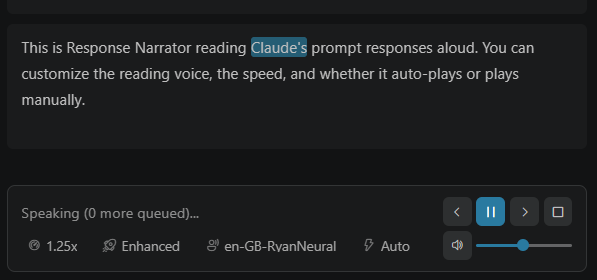

# Response Narrator

Response Narrator is a VS Code extension that reads new Claude Code assistant responses aloud via text-to-speech by watching its session transcript files.

If you find this useful, consider [sponsoring on GitHub](https://github.com/sponsors/TitanRIU).

## Getting Started

1. Install the extension. It activates automatically and starts watching your Claude Code session transcripts. No setup required.
2. By default it's in **Auto** mode: new Claude Code responses are read aloud as they arrive.
3. Click **Narrator** in the status bar (bottom right of the window) to open the Response Narrator panel. Or use the keyboard shortcuts, `Ctrl+Alt+P` to play/pause and `Ctrl+Alt+S` to stop, from anywhere.
4. The panel has its own control bar at the bottom: **Skip Back**, **Play/Pause**, **Skip Forward**, and **Stop** buttons, plus **Speed**, **Voice Engine** (System or Enhanced), **Voice**, and **Playback** mode (Auto or Manual), each opening a small popup to change it on the spot. Skip Back/Forward step through the current response's paragraphs one at a time, moving into the next or previous response once you reach either end. The same settings, plus Report Issue / Give Feedback, are also reachable via the "Response Narrator: Open Menu" command.
5. Switch to **Manual** mode if you'd rather only hear a response when you press Play, on demand.
6. The first time you use the **Enhanced** voice engine, you'll see a one-time prompt in the Response Narrator panel. Click **Enable** there to unlock audio playback (a one-time browser security requirement, not needed again after that).

## Features

- Watches your Claude Code session transcripts and reads new assistant responses aloud as they arrive, or only on demand, depending on Playback mode.
- Two voice engines: **System** (built-in OS voices: instant, works offline) and **Enhanced** (higher-quality neural voices via Microsoft Edge's online text-to-speech service), with automatic fallback to System if Enhanced is unavailable.
- Live word-by-word highlighting in the Response Narrator panel, synced to whichever engine is speaking.
- The transcript stays visible and scrollable across the current response and the last few before it, instead of disappearing after each chunk. Click any word to replay from that exact point.
- Skip Back/Forward, Play/Pause/Stop, and all playback settings (Speed, Voice Engine, Voice, Playback mode) live directly on a control bar in the Response Narrator panel, plus keyboard shortcuts (`Ctrl+Alt+P` to play/pause, `Ctrl+Alt+S` to stop) from anywhere. Skip Back/Forward move one paragraph at a time, spanning across responses.
- Voice picker for both engines: a flat searchable list for System, and a language → region → voice drill-down for Enhanced's 300+ voices across 140+ locales.
- Responses are split into natural-sounding chunks one paragraph at a time, with a long paragraph further split at a sentence boundary where possible, falling back to a comma or other natural pause before ever cutting mid-word.
- Code blocks are announced (e.g. "TypeScript code block, 12 lines") instead of being read aloud character by character.

## Requirements

- The [Claude Code](https://marketplace.visualstudio.com/items?itemName=anthropic.claude-code) VS Code extension. Response Narrator reads its session transcripts, so it has nothing to narrate without it.
- It watches the Claude Code session(s) for the workspace folder(s) open in that same VS Code window. If you run Claude Code in multiple VS Code windows at once, each narrates only its own project.
- The Enhanced voice engine requires network access; the System voice engine works fully offline.

## Privacy

When using the **Enhanced** voice engine, the text of each response (with fenced code blocks replaced by a short spoken summary rather than sent as-is) is sent to Microsoft's Edge text-to-speech service to be synthesized into audio. This is an unofficial, undocumented API, not a formal Microsoft product. If you'd rather nothing leave your machine, use the **System** engine instead, which runs entirely offline through your OS's built-in voices.

## Status

Actively developed and working. See [IDEAS.md](IDEAS.md) for what's being considered next.

## Feedback

Found a bug or have a feature request? [Open an issue](https://github.com/TitanRIU/Response-Narrator/issues), or use the "Response Narrator: Report Issue / Give Feedback" entry in the extension's own menu, which opens the same page. For more open-ended ideas or questions, use [Discussions](https://github.com/TitanRIU/Response-Narrator/discussions) instead.
